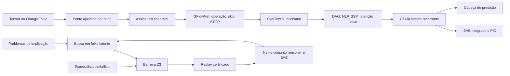

# Arquitetura e contratos

## Caminhos executáveis

O caminho tabular e o de dedução compartilham células e SAE. Ao receber um modelo
sintetizado, o monitor cria um reasoner de proposições com cópias desses componentes
e uma cabeça de vocabulário própria. Isso transfere parâmetros; a transferência
de competência entre os domínios deve ser medida. O dataset tabular não é convertido
implicitamente em axiomas verdadeiros.

## Implementação por subsistema

| Módulo | Contrato implementado | Limite explícito |
|---|---|---|
| `core.manifold` | SVD centralizada, energia acumulada, amostra estratificada e reprodutível | Até 512 linhas por padrão; dados finitos; dimensão zero para dados constantes |
| `core.orange_bridge` | One-hot, imputação/Z-score ajustados, dados esparsos e exportação de features | Materializa matrizes esparsas; orçamento de memória é responsabilidade do chamador |
| `verifier.zerocost` | SynFlow com pesos absolutos; SNIP; proxy VJP e espectro exato pequeno | Usa cópia do modelo; índices de embeddings requerem wrapper contínuo |
| `verifier.mup` | Inicialização por fan-in e LR dos readouts proporcional a 1/largura | Receita finita; não uma prova de limite assintótico |
| `verifier.curvature` | Hutchinson e iteração de potência por produtos Hessiano-vetor | Custo cresce com o orçamento de amostras/iterações |
| `synthesis.space` | DAG acíclico, fusão de pais, MLP residual, SSM diagonal causal, atenção linear | Todos os estados internos têm largura comum; atenção não causal |
| `synthesis.gflownet` | Política condicionada no fingerprint; treinamento trajectory balance | Família canônica de DAGs com predecessor único; recompensa heurística |
| `synthesis.jit_compiler` | Eager, `aot_eager`, Inductor e kernel RMS residual Triton | Triton requer CUDA, dtypes suportados e inferência sem autograd |
| `engine.latent_ttc` | Recorrência contínua, valor Softplus, expansão/poda em feixe e históricos | Valor treinado é um proxy, sem calibração epistemológica garantida |
| `engine.dynamic_depth` | Saída por entropia por amostra e mínimo de passos | Entropia baixa não é certificação formal |
| `interpretability` | TopK/JumpReLU com surrogate gradient, decoder normalizado, PID com anti-windup | L0 TopK é um teto; semântica das unidades exige anotação |
| `formal.z3_gateway` | Consistência dos axiomas, refutação, proof object e contraexemplo | Confiança no solver e nos axiomas; unknown falha fechado |
| `formal.lean_bridge` | Processo assíncrono isolado por arquivo, timeout, prova proposicional e auditoria de axiomas | Lean 4; subconjunto permitido de provas; sem Mathlib neste release |
| `evolution.replay_buffer` | Admissão pelo verificador, deduplicação, capacidade limitada, JSON atômico | Revalida no carregamento; o hash não é assinatura criptográfica de autenticidade |
| `evolution.loop` | STaR/expert iteration, treino SAE no mesmo grafo, checkpoints, platô e expansão | Gerador de problemas limitado a implicações entre proposições |
| `evolution.net2net` | Net2Wider com divisão por multiplicidade e preservação de gradientes | Somente pares Linear-ativação elementwise-Linear; sem ruído |
| `orange` | Três widgets, sinais tipados, erros, cancelamento e gráficos | Eventos Qt em desktop ou testes offscreen; renderização 3D via Matplotlib |

## Fórmula de expansão corrigida

Se `g(j)` mapeia cada neurônio novo para um neurônio antigo e `c(i)` é seu número
de cópias, usamos:

- `W_in'[j] = W_in[g(j)]`, `b_in'[j] = b_in[g(j)]`;
- `W_out'[:, j] = W_out[:, g(j)] / c(g(j))`;
- `b_out' = b_out`.

A soma das contribuições de todas as cópias reproduz a contribuição original.
Escalar ambas as camadas por `1/sqrt(k)` ou adicionar ruído não fornece essa
identidade para ativações gerais. Os testes verificam saídas e derivadas de entrada
com ReLU, GELU, Tanh e Sigmoid, usando dupla precisão.

## Certificação, treino e persistência

A certificação é relativa às premissas. Antes da refutação, o gateway exige que
a base seja satisfatível. Só `UNSAT` da negação da conclusão produz certificado.
Exemplos aceitos são codificados diretamente das regras, sem truncar a sequência.
Padding usa um token reservado, diferente da proposição `P_0`; o encoder preserva
informação posicional. O replay guarda a proposta de origem (`model`/`expert`).

Checkpoints usam `torch.load(..., weights_only=True)`, pesos e metadados simples,
sem serializar instâncias vivas. O replay é revalidado na restauração. A gravação
usa arquivo temporário no destino e substituição atômica. `NextorchModel.save/load`
preserva o pré-processamento tabular; o checkpoint do engine preserva também
estado do otimizador, PID e geradores aleatórios para continuidade em CPU.

A barreira padrão do loop é Z3. `NextorchConfig(require_lean=True)` exige
aprovação independente do Lean para cada admissão, e o replay preserva essa
política na persistência. Lean também pode ser usado diretamente pela API/CLI.
